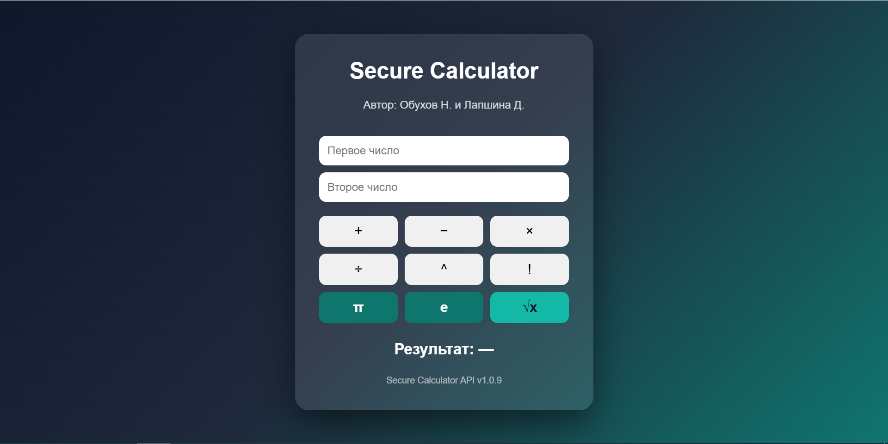

# Secure Calculator API

[](https://github.com/Nikisisisi/Secure-calculator/actions/workflows/ci.yml)

Учебный проект по дисциплине **«Методы оценки безопасности компьютерных систем»**.

**Авторы:** Nikita Obukhov & Daria Lapshina

---

## О проекте

Secure Calculator — учебное веб-приложение и REST API для математических вычислений на Python и FastAPI, разработанное с акцентом на безопасную обработку входных данных, автоматизированное тестирование и DevSecOps.

Проект объединяет удобный веб-интерфейс, интерактивную документацию Swagger UI, Docker-контейнеризацию и многоуровневые проверки безопасности в GitHub Actions.

### Возможности калькулятора

| Операция | API endpoint | Пример |
|---|---|---|
| Сложение | `POST /calculate/add` | 10 + 5 = 15 |
| Вычитание | `POST /calculate/subtract` | 10 − 5 = 5 |
| Умножение | `POST /calculate/multiply` | 10 × 5 = 50 |
| Деление | `POST /calculate/divide` | 10 ÷ 5 = 2 |
| Возведение в степень | `POST /calculate/power` | 2⁵ = 32 |
| Факториал | `POST /calculate/factorial` | 5! = 120 |
| Квадратный корень | `POST /calculate/sqrt` | √25 = 5 |

### Scientific Edition

Веб-интерфейс дополнительно поддерживает математические константы:

- **π (Пи)** — `3.141592653589793`;
- **e (число Эйлера)** — `2.718281828459045`.

Константы подставляются в выбранное поле ввода и могут использоваться в существующих математических операциях. Отдельные API endpoints для констант не требуются.

### Безопасность и качество

В проекте реализованы валидация входных данных через Pydantic, ограничения вычислительных операций, защитные HTTP-заголовки и Content Security Policy (CSP).

Перед автоматическим выпуском новой версии приложение проходит функциональные тесты, API fuzz testing, статический анализ, аудит зависимостей, проверку секретов и сканирование Docker-образа.

Для каждого успешного выпуска CI дополнительно формирует Software Bill of Materials (SBOM) в формате CycloneDX.

---

## Интерфейс приложения

Ниже представлен веб-интерфейс калькулятора:



---

## Используемые технологии

- Python 3.13
- FastAPI
- Uvicorn
- Pydantic
- Pytest
- Docker
- Git
- GitHub

---

# Быстрый запуск через Docker

Это рекомендуемый способ запуска проекта.

## 1. Клонировать репозиторий

```bash
git clone https://github.com/Nikisisisi/Secure-calculator.git
```

Перейти в папку проекта:

```bash
cd Secure-calculator
```

## 2. Собрать Docker-образ

```bash
docker build --pull -t secure-calculator:local .
```

## 3. Запустить контейнер

```bash
docker run -d --name secure-calculator -p 8000:8000 secure-calculator:local
```

## 4. Открыть приложение

Веб-интерфейс:

```text
http://127.0.0.1:8000/web
```

Swagger UI:

```text
http://127.0.0.1:8000/docs
```

Проверка состояния API:

```text
http://127.0.0.1:8000/health
```

## 5. Остановить контейнер

```bash
docker stop secure-calculator
```

Удалить контейнер:

```bash
docker rm secure-calculator
```

---

# API

Калькулятор предоставляет следующие методы:

| Метод | Endpoint | Описание |
|---|---|---|
| GET | `/` | Информация о работе API |
| GET | `/health` | Проверка состояния приложения |
| GET | `/web` | Веб-интерфейс калькулятора |
| POST | `/calculate/add` | Сложение |
| POST | `/calculate/subtract` | Вычитание |
| POST | `/calculate/multiply` | Умножение |
| POST | `/calculate/divide` | Деление |
| POST | `/calculate/power` | Возведение в степень |
| POST | `/calculate/factorial` | Вычисление факториала |
| POST | `/calculate/sqrt` | Вычисление квадратного корня |

Пример запроса:

```json
{
  "a": 10,
  "b": 5
}
```

Пример ответа:

```json
{
  "result": 15
}
```

Пример вычисления факториала:

```json
{
  "n": 5
}
```

Ответ:

```json
{
  "result": 120
}
```

Для операции факториала принимается только целое значение `n` в диапазоне от `0` до `100`. Ограничение защищает приложение от неконтролируемого потребления вычислительных ресурсов.


### Квадратный корень

Пример запроса к `POST /calculate/sqrt`:

```json
{
  "a": 25
}
```

Пример ответа:

```json
{
  "result": 5.0
}
```

Для операции квадратного корня разрешены числовые значения от `0` до `1 000 000` включительно.

Отрицательные числа, строки, булевы значения и другие некорректные типы отклоняются с HTTP `422`.

Веб-интерфейс дополнительно поддерживает кнопки `π` и `e` для подстановки математических констант в выбранное поле ввода.


При попытке деления на ноль API возвращает HTTP-ошибку `400`.

---

# Автоматические тесты

Для проекта реализованы автоматические тесты с использованием `pytest`.

Проверяются:

- корневой endpoint;
- health-check;
- сложение;
- вычитание;
- умножение;
- деление;
- возведение в степень;
- вычисление факториала;
- вычисление квадратного корня;
- отклонение отрицательных чисел и некорректных типов;
- проверку граничных значений квадратного корня;
- защитные HTTP-заголовки и Content Security Policy (CSP).
- граничные и некорректные значения факториала;
- деление на ноль;
- некорректные входные данные;
- работа веб-интерфейса.

Всего реализовано:

```text
31 tests
```

Запуск тестов:

```bash
python -m pytest
```

Текущий результат:

```text
31 passed
```

---

# ⚡ Проверка производительности

Для базовой проверки производительности API было выполнено **100 последовательных POST-запросов** к методу:

```text
POST /calculate/add
```

Результаты локального тестирования приложения в Docker-контейнере:

| Показатель | Результат |
|---|---:|
| Количество запросов | 100 |
| Среднее время | 10.59 мс |
| Минимальное время | 8.34 мс |
| Максимальное время | 20.22 мс |

Тест выполнялся локально через PowerShell.

Результаты являются ориентировочными и не представляют собой полноценное нагрузочное тестирование.

---

# Локальный запуск без Docker

Создать виртуальное окружение:

```bash
python -m venv .venv
```

Для Windows PowerShell активировать его:

```powershell
.\.venv\Scripts\Activate.ps1
```

Установить зависимости:

```bash
pip install -r requirements.txt
```

Запустить приложение:

```bash
uvicorn app.main:app --reload
```

После запуска приложение будет доступно по адресу:

```text
http://127.0.0.1:8000
```

---

# 📁 Структура проекта

```text

secure-calculator/
├── .github/
│   └── workflows/
│       └── ci.yml
├── app/
│   ├── __init__.py
│   ├── main.py
│   ├── index.html
│   └── static/
│       ├── script.js
│       └── styles.css
├── assets/
│   └── web-ui.png
├── docs/
│   └── SECURITY_ANALYSIS.md
├── reports/
│   └── ... (JSON-отчёты предыдущих проверок)
├── scripts/
│   └── bump_version.py
├── security/
│   ├── semgrep-rules.yml
│   └── zap-rules.conf
├── tests/
│   └── test_calculator.py
├── .dockerignore
├── .gitleaks.toml
├── .gitignore
├── Dockerfile
├── README.md
├── requirements.txt
├── requirements-dev.txt
└── VERSION
```

---

# 🐳 Docker

Проект использует базовый образ:

```text
python:3.13-slim
```

Приложение внутри контейнера запускается через Uvicorn и использует порт:

```text
8000
```

---

# Безопасность и DevSecOps

Безопасность Secure Calculator проверяется автоматически при каждом push в ветку `main` с помощью GitHub Actions.

Проект использует подход **Security Gates**: если обязательная проверка завершается с ошибкой, автоматический выпуск новой версии останавливается.

## Инструменты проверки

| Инструмент | Назначение | Результат CI #11 |
|---|---|---|
| pytest | Функциональные и регрессионные тесты | 31 passed |
| Schemathesis | Проверка и fuzz testing API по OpenAPI | 987/987 passed |
| OWASP ZAP | Динамическое сканирование безопасности API (DAST) | 0 FAIL, 0 WARN, 119 PASS |
| pip-audit | Поиск известных уязвимостей Python-зависимостей | Уязвимости не обнаружены |
| Semgrep | Статический анализ исходного кода (SAST) | 0 findings |
| Gitleaks | Поиск секретов в Git-истории | Утечки не обнаружены |
| Trivy Config | Проверка конфигурации Docker | Пройдена |
| Trivy Image | Проверка уязвимостей Docker-образа | Пройдена |

## Software Bill of Materials (SBOM)

После сборки Docker-образа инструмент **Syft** автоматически формирует SBOM в формате **CycloneDX JSON**.

Для версии `1.0.9` SBOM содержит **2 782 компонента**. Отчёт загружается в GitHub Actions Artifacts и доступен для скачивания.

**Подтверждённый запуск CI:** [GitHub Actions #11](https://github.com/Nikisisisi/Secure-calculator/actions/runs/38363354555)

**SBOM версии 1.0.9:** [secure-calculator-sbom-1.0.9](https://github.com/Nikisisisi/Secure-calculator/actions/runs/38363354555/artifacts/11795148997)

Результаты сканирования отражают состояние проекта на момент проверки и не являются гарантией полного отсутствия уязвимостей.

Подробный анализ обнаруженных проблем, выполненных исправлений и повторных проверок представлен в [отчёте по безопасности](docs/SECURITY_ANALYSIS.md).

---

# CI/CD и автоматическое версионирование

Для проекта настроен CI-пайплайн с использованием **GitHub Actions**.

Конфигурация пайплайна находится в:

```text
.github/workflows/ci.yml
```

Pipeline автоматически запускается при каждом push в ветку `main`.

Последовательность выполнения:


```text
Push в main
    |
    v
Checkout + Python 3.13
    |
    v
Установка зависимостей
    |
    v
Подготовка новой версии
    |
    v
pytest (функциональные и security-тесты)
    |
    v
Schemathesis (API fuzz testing)
    |
    v
OWASP ZAP (DAST)
    |
    v
pip-audit (аудит зависимостей)
    |
    v
Semgrep (SAST)
    |
    v
Gitleaks (поиск секретов)
    |
    v
Trivy Config (Docker security)
    |
    v
Сборка Docker-образа
    |
    v
Syft (генерация CycloneDX SBOM)
    |
    v
Upload SBOM в GitHub Artifacts
    |
    v
Trivy Image (сканирование образа)
    |
    v
Commit и push новой версии
```


Для хранения текущей версии используется файл:

```text
VERSION
```

Для автоматического повышения версии используется скрипт:

```text
scripts/bump_version.py
```

Используется схема версий:

```text
MAJOR.MINOR.PATCH
```

На данном этапе pipeline автоматически увеличивает `PATCH`-часть версии:

```text
1.0.0 → 1.0.1 → 1.0.2
```

Новая версия автоматически используется:

- FastAPI-приложением;
- Swagger;
- веб-интерфейсом;
- Docker-образом;
- README;
- файлом `VERSION`.

## Пример работы pipeline


## Пример работы pipeline: выпуск Scientific Edition 1.0.9

В рамках развития проекта был добавлен защищённый API-метод:

`POST /calculate/sqrt`

Также веб-интерфейс получил кнопки `π`, `e` и `√x`.

После отправки изменений в GitHub был запущен автоматический CI/CD-пайплайн.

### Результаты GitHub Actions #11

- **pytest:** 31 тест успешно пройден.
- **Schemathesis:** 987 сгенерированных проверок успешно пройдены.
- **OWASP ZAP:** 0 FAIL, 0 WARN, 119 PASS.
- **pip-audit:** известных уязвимостей не обнаружено.
- **Semgrep:** 0 findings.
- **Gitleaks:** утечек секретов не обнаружено.
- **Trivy:** проверки конфигурации и Docker-образа пройдены.
- **Syft:** сформирован CycloneDX SBOM, содержащий 2 782 компонента.

После успешного завершения обязательных проверок GitHub Actions автоматически повысил версию:

`1.0.8 → 1.0.9`

Автоматический коммит:

`96967e6 — chore: bump version to 1.0.9`

**Подтверждение:** [успешный GitHub Actions #11](https://github.com/Nikisisisi/Secure-calculator/actions/runs/38363354555).

Таким образом, выпуск новой версии зависит от успешного прохождения функциональных тестов, проверок безопасности и анализа Docker-образа.


# Версия

Текущая версия приложения:

<!-- VERSION:START -->
`1.0.9`
<!-- VERSION:END -->